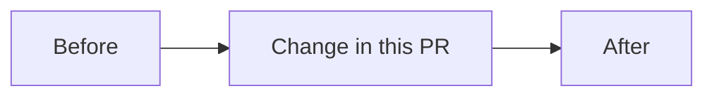

# Engineering Knowledge System — Field Guide

## Concept

One vault. Every project. Every feature. Every session, analysis, bug, ticket, incident, update and decision.
All connected as a navigable tree. Plug and play for any project in the world.
Analytics-ready by design — every file has consistent YAML queryable via Obsidian Dataview.

---

## Content Style — write for a time-poor human reader

Every entity is read by busy humans, so write it like a **storyteller**, not a log dump:

- Lead with a short **plain-language narrative** — what happened, why it matters, how it works.
  No jargon walls. A newcomer (or a fresh Claude session) should grasp it in one read.
- Use **tables whenever the data is definite/structured** — review findings, fields, steps,
  comparisons, before/after. Tables scan faster than prose for structured facts.
- Prefer a small mermaid diagram over a paragraph when explaining a flow.
- Favor **clarity and scannability over completeness** — capture what matters, link the rest.

The PR-review template below models this (plain language + findings table + mermaid). Apply the same
spirit to bugs, sessions, info files, incidents, and decisions.

---

## Folder Structure

```
knowledge/
  _index.md                          <- vault root: lists all projects
  _guide.md                          <- this file

  projects/
    {project}/
      {project}.md                   <- project hub
      systems/                       <- ONLY shared cross-feature infrastructure
        sys-{name}.md
      features/
        {feat}/
          {feat}.md                  <- feature hub: navigation only (Dataview queries — never add prose here)
          info-{name}.md             <- living specification: what it is, how it works, known behaviors
          sessions/                  <- daily work logs
          analysis/                  <- exploratory investigations (no code change)
          bugs/                      <- defects
          tickets/                   <- customer-reported issues
          incidents/                 <- production failures
          updates/                   <- feature changes (add/modify/remove/deprecate)
          decisions/                 <- technical choices and what was rejected
          pr-reviews/                <- pull-request reviews (linked to bugs/features)

      skills/                        <- reusable Claude operational patterns extracted from sessions
        skl-{name}.md

      analysis/                      <- cross-feature or architectural investigations
```

---

## Naming Conventions

| Entity    | Prefix  | Pattern                        | Example                                    |
|-----------|---------|--------------------------------|--------------------------------------------|
| Project   | —       | `{name}`                       | `acme-app`                                 |
| Feature   | `feat-` | `feat-{name}`                  | `feat-payment-retry`                       |
| Info      | `info-` | `info-{name}`                  | `info-payment-retry`                       |
| Session   | `ses-`  | `ses-YYYY-MM-DD-{description}` | `ses-2026-05-22-debug-payment-timeout-issue` |
| Bug       | `bug-`  | `bug-YYYY-MM-DD-{description}` | `bug-2026-05-23-file-upload-fails-on-mobile` |
| Ticket    | `tkt-`  | `tkt-YYYY-MM-DD-{description}` | `tkt-2026-05-24-ai-summary-slow-responses` |
| Incident  | `inc-`  | `inc-YYYY-MM-DD-{description}` | `inc-2026-05-23-payment-api-timeout-under-load` |
| Update    | `upd-`  | `upd-YYYY-MM-DD-{description}` | `upd-2026-05-25-switch-ai-model-to-claude` |
| Decision  | `dec-`  | `dec-{name}`                   | `dec-payment-retry-limit-strategy`         |
| Analysis  | `anl-`  | `anl-YYYY-MM-DD-{description}` | `anl-2026-05-22-understand-retry-lock-behavior` |
| System    | `sys-`  | `sys-{name}`                   | `sys-payment-api`                          |
| Skill     | `skl-`  | `skl-{name}`                   | `skl-h3-hex-validation`                    |
| PR Review | `pr-`   | `pr-YYYY-MM-DD-{description}`  | `pr-2026-06-15-fix-territory-capture-race` |

Rules:
- Minimum 3 words in the description part of the name (prefer 4+ for clarity)
- Sessions, bugs, tickets, incidents, updates, analyses, pr-reviews: date-first (events in time)
- Decisions and systems: no date in name (permanent knowledge — date goes in YAML only)
- Systems: shared infrastructure only — feature-specific system info lives in the info file
- Use lowercase kebab-case for all descriptions

---

## YAML Schema

### Universal fields (every file)

```yaml
type:     # project | feature | session | analysis | bug | ticket | incident | update | decision | system | skill | pr-review
title:    # human-readable display name (used by dashboard and graph)
date:     # YYYY-MM-DD
project:  # project name
feature:  # feat-name  (omit for project-level files and systems)
author:   # engineer who created this
status:   # see per-type values below
tags:     # [free, form, labels]
```

> **No synthetic IDs.** Files are identified by their filename (e.g. `bug-2026-06-18-...`). There is
> **no** auto-increment `id:` field — it was removed because such numbers collide across projects and
> carry no real meaning. An entity's displayed work-item badge is its *real* tracker reference (see
> the work-item fields below); entities with no tracker show a typed date/name label
> (e.g. `SES·2026-06-18`, `DEC·delta-push`) computed by `build_data.py`.

### Work-item reference (tracked entities: bug, ticket, incident, update, pr-review; session/decision when they map to a work item)

```yaml
tracker:  # github | azure | jira | gitlab | linear   — the project's tracker; omit if the item has none
ref-id:   # the tracker's OWN number/key, verbatim: 24 (GitHub/Azure), PROJ-42 (Jira), ENG-7 (Linear)
ref-url:  # "https://github.com/org/repo/issues/24"   — deep link (optional)
```

Rules:
- Capture the work-item ID from the real tracker when one exists. **Never invent or auto-number it.**
- The repo's `.knowledge.json` may declare a default `tracker` and a `repo-url` base so links can be
  built consistently. If the work hasn't been filed in a tracker, omit all three fields.
- Dashboard badge per tracker: GitHub/GitLab → `#24`, Azure → `AB#24`, Jira/Linear → the key verbatim.

### Role field (feature + system + project files only)

```yaml
role:     # hub | info | system
          # hub     — feature hub or project hub (navigation only)
          # info    — feature living specification
          # system  — shared infrastructure file
          # omit for all other entity types (sessions, bugs, tickets, etc.)
```

### Per-type additional fields

```yaml
# project
name:     # project slug (matches folder name)

# bug
severity: critical | high | medium | low

# ticket
severity: critical | high | medium | low
customer: customer or team name
# external tracker reference uses the universal tracker/ref-id/ref-url fields above

# incident
severity: critical | high | medium | low
impact:   description of blast radius

# decision
prompted-by: "[[bug-|tkt-|inc-|ses-]]"   <- what caused this decision (omit if initial design choice)

# update
change-type:  add | modify | remove | deprecate
triggered-by: "[[inc-or-bug-that-caused-this]]"   <- chain link
spawned:      "[[upd-created-as-result]]"          <- set on the incident/bug that triggered it

# skill
features:     [feat-name, feat-other]              # list; omit or [] for cross-feature skills
category:     architecture | patterns | testing | performance | security | gotchas | data-model
repo-path:    ".claude/skills/{category}/SKILL.md" # repo copy location (omit if not synced)
derived-from: "[[ses-YYYY-MM-DD-xxx]]"             # session that surfaced this knowledge

# pr-review
status:       open | changes-requested | approved | merged
kind:         bugfix | feature | refactor | chore   # bugfix → links to a bug; others → link feature only
tracker:      github                                # the PR's host; drives the badge (#123)
ref-id:       123                                   # the PR number — this PR *is* the work item
ref-url:      "https://github.com/org/repo/pull/123" # link to the PR (optional)
reviews:      "[[bug-YYYY-MM-DD-xxx]]"              # the bug this PR fixes (omit for non-bugfix PRs)
```

### Files field (all work entities — session, bug, ticket, incident, analysis, update)

```yaml
files:      # list of source code files touched, analyzed, or relevant to this work
  - path: src/services/sync-gateway.ts
    role: modified              # modified | analyzed | root-cause | created | deleted
  - path: tests/sync.test.ts
    role: created
  - path: src/lib/delta-engine.rs
    role: analyzed
```

Roles:
- `modified` — file was changed as part of this work
- `analyzed` — file was read/investigated to understand behavior
- `root-cause` — the bug or defect lives in this file
- `created` — new file introduced
- `deleted` — file was removed

Rules:
- Use workspace-relative paths (from project root)
- Record files as you work — don't wait until the end
- Include test files if they were added or changed
- For bugs: always mark the root-cause file(s)

### Status vocabulary

| Type | Valid statuses |
|------|---------------|
| project | active, archived |
| feature | active, deprecated, removed |
| session | complete |
| analysis | complete, in-progress |
| bug | open, in-progress, resolved, wont-fix, duplicate |
| ticket | open, in-progress, resolved, wont-fix |
| incident | open, investigating, mitigated, resolved |
| update | planned, in-progress, implemented, reverted |
| decision | proposed, active, superseded, revoked |
| system | active, deprecated, decommissioned |
| skill | active, deprecated, superseded |

---

## Content Templates

### Project Hub  `{project}.md`  — navigation only

```markdown
# {Project Title}

## Features

```dataview
TABLE status FROM "projects/{project}/features" WHERE role = "hub" SORT file.name ASC
```

## Systems

```dataview
TABLE status FROM "projects/{project}/systems" SORT file.name ASC
```
```

---

### Feature Hub  `{feat}.md`  — navigation only

```markdown
# {Feature Title}

## Key Behaviors
  <!-- 2-3 line summary of what this feature does -->

# Related
- [[{project}]]
```

---

### Feature Info  `info-{name}.md`  — all knowledge lives here

```markdown
# Current Architecture
### Components
### Known Behaviors
### Edge Cases

## File Map
  <!-- Key source files for this feature — updated as work happens -->
  <!-- Format: `path/to/file.ext` — one-line description of what it does -->
  <!-- Example:
  - `src/services/sync-gateway.ts` — WebSocket connection manager, handles reconnect logic
  - `src/lib/delta-engine.rs` — Binary diff computation, rsync algorithm implementation
  - `tests/sync.test.ts` — Integration tests for real-time sync flows
  -->

## Integration Points
## Open Questions

# Related
- [[{feat}]]
```

### Analysis  `anl-YYYY-MM-DD-{description}.md`

```markdown
# Goal
  <!-- What were you trying to understand? -->
# What I Found
# Open Questions
  <!-- Things you still don't know — creates a trail for the next investigation -->
# Diagrams or Code Snippets
# Follow-up Actions
  <!-- If nothing: state "No changes needed" explicitly -->

# Related
- [[{feat}]]   <- omit if cross-feature; link project hub instead
```

---

### Session  `ses-YYYY-MM-DD-{description}.md`

```markdown
# What I Did
# Problems I Hit
# Decisions Made
# What I Chose NOT To Do — and Why
# Next Steps

# Related
- [[{feat}]]
```

### Bug  `bug-YYYY-MM-DD-{description}.md`

```markdown
# Description
# Steps to Reproduce
# Expected Behavior
# Actual Behavior
# Root Cause
# Fix
  <!-- Use "# Workaround" or "# Proposed Fix" if not yet resolved -->

# Related
- [[{feat}]]
```

### Ticket  `tkt-YYYY-MM-DD-{description}.md`

```markdown
# Request
# Customer Context
# Proposed Solution
# Priority

# Related
- [[{feat}]]
```

### Incident  `inc-YYYY-MM-DD-{description}.md`

```markdown
# Timeline
# Root Cause
# Resolution
# Impact
# Lessons Learned

# Related
- [[{feat}]]
```

### Update  `upd-YYYY-MM-DD-{description}.md`

```markdown
# What Changed
# Why
# Impact

# Related
- [[{feat}]]
- [[{triggered-by}]]   <- the bug/incident/ticket that caused this
```

### Decision  `dec-{name}.md`

```markdown
# Context
# Decision
# Alternatives Considered
# Consequences

# Related
- [[{feat}]]
- [[{prompted-by}]]      <- bug/ticket/incident/session that triggered this decision (omit if initial design)
```

### System  `sys-{name}.md`

```markdown
# {System Title}
### Architecture
### Known Behaviors
### Integration Points

# Related
- [[{project}]]
```

---

### Skill  `skl-{name}.md`

```markdown
---
type: skill
title: "{Skill Title}"
project: {project}
features: []
category: {category}
status: active
author: {author}
date: YYYY-MM-DD
derived-from: "[[ses-]]"
repo-path: ""
tags: []
---

# {Skill Title}

## When to Activate
<!-- Conditions that should trigger applying this skill -->

## {Core content — patterns, rules, code snippets, checklists}

# Related
- [[{project}]]
- [[{derived-from}]]
```

Every skill is owned by a project: it MUST have a `project:` field and a `[[{project}]]` link in
`# Related`. Use the `features:` list when it applies to specific features.

---

### PR Review  `pr-YYYY-MM-DD-{description}.md`

Write for a non-technical reader: short sentences, plain words, a diagram. Use a mermaid diagram in
**How It Works** and a table in **Review Findings** so the page is scannable.

```markdown
---
type: pr-review
title: "{Plain-language PR title}"
project: {project}
feature: {feat}
status: merged
kind: bugfix
author: {author}
date: YYYY-MM-DD
tracker: github
ref-id: 123
ref-url: "https://github.com/org/repo/pull/123"
reviews: "[[bug-YYYY-MM-DD-xxx]]"   # omit when kind is not bugfix
files: []
tags: []
---

# What This PR Does
<!-- One or two plain sentences anyone can understand. -->

# Why It Was Needed
<!-- The problem in everyday language. For a bugfix, say what was broken and why it happened. -->

# How It Works


# Review Findings
| Severity | Finding | Resolved? |
|----------|---------|-----------|
| —        | —       | —         |

# Linked Bug / Feature
<!-- What this PR is solving and how it connects to the bug/feature. -->

## Evolution
- YYYY-MM-DD — PR reviewed and captured.

# Related
- [[{feat}]]
- [[bug-YYYY-MM-DD-xxx]]   <- omit for non-bugfix PRs
```

---

## Evolution / Living History (every living doc)

Living docs (info files, feature/project hubs, specs, bugs, pr-reviews) carry a `## Evolution`
section — a dated trail of how the doc changed:

```markdown
## Evolution
- 2026-06-15 — Created. <initial state>.
- 2026-06-18 — <what changed and why>.
```

Rules:
- **Append** a `- YYYY-MM-DD — <concise change>` line on every meaningful update.
- **Current-state sections stay current** (Architecture, Known Behaviors, File Map reflect *today*);
  the Evolution trail records *how it got there*.
- **Compact as it grows**: merge same-topic lines and roll older months into one summary line, but
  always keep the creation entry and milestone changes. Never delete the fact that something
  changed — summarize it.

---

## Chain Reaction Rules

When a bug, ticket, or incident is resolved AND the fix changes observable feature behavior:

1. Create an `upd-` record for the feature
2. Set `triggered-by: "[[inc/bug/tkt]]"` on the upd- file
3. Set `spawned: "[[upd-]]"` on the incident/bug/ticket file

This creates a traceable chain in the graph:
```
inc- --spawned--> upd- --triggered-by--> inc-
```

---

## Linking Rules

- Every entity has a `# Related` section at the bottom with wikilinks
- Feature-level entities link to their **feature hub** in Related
- Feature hub links to its **project hub** in Related
- Shared systems link to the **project hub** in Related
- Cross-references to related sessions, bugs, decisions, etc. go in Related
- `triggered-by` and `prompted-by` are YAML fields (not markdown links)
- Use `[[filename-without-extension]]` format for all wikilinks

---

## Dataview Query Templates

Copy-paste ready. Replace `{project}` and `{feat}` with real values.

**Feature Hub sections** — one query block per `## Section` heading:

```text
Sessions:   TABLE date, author FROM "projects/{project}/features/{feat}/sessions" SORT date DESC
Analysis:   TABLE date, author, scope FROM "projects/{project}/features/{feat}/analysis" SORT date DESC
Tickets:    TABLE date, status, customer FROM "projects/{project}/features/{feat}/tickets" SORT date DESC
Updates:    TABLE date, change-type, status FROM "projects/{project}/features/{feat}/updates" SORT date DESC
Bugs:       TABLE date, status, severity FROM "projects/{project}/features/{feat}/bugs" SORT date DESC
Decisions:  TABLE date, status, decision-type FROM "projects/{project}/features/{feat}/decisions" SORT date DESC
Incidents:  TABLE date, status, severity FROM "projects/{project}/features/{feat}/incidents" SORT date DESC
PR Reviews: TABLE date, status, kind, ref-id FROM "projects/{project}/features/{feat}/pr-reviews" SORT date DESC
```

**Index Dashboard:**

```text
Open Bugs:      TABLE date, project, feature, severity FROM "" WHERE type = "bug" AND (status = "open" OR status = "in-progress") SORT date DESC
Open Incidents: TABLE date, project, feature FROM "" WHERE type = "incident" AND (status = "open" OR status = "investigating" OR status = "mitigated") SORT date DESC
Open Tickets:   TABLE date, project, feature, customer FROM "" WHERE type = "ticket" AND (status = "open" OR status = "in-progress") SORT date DESC
Recent Work:    TABLE date, project, feature, author FROM "" WHERE type = "session" SORT date DESC LIMIT 10
```

---

## Obsidian Graph Filters

| Query | Shows |
|-------|-------|
| `path:projects/acme-app` | Everything in one project |
| `property:feature:feat-payment-retry` | One feature and all its entities |
| `property:type:bug` | All bugs across all projects |
| `property:status:open` | All open items |
| `property:severity:critical` | All critical issues |
| `property:author:robin` | Everything one engineer worked on |
| `property:change-type:remove` | All removed features |
| `property:triggered-by` | All updates that were chain-reaction results |
| `property:type:analysis` | All exploratory investigations |
| `property:scope:cross-feature` | Cross-feature analyses only |
| `property:role:info` | All living information files |
| `property:role:hub` | All navigation hub files |