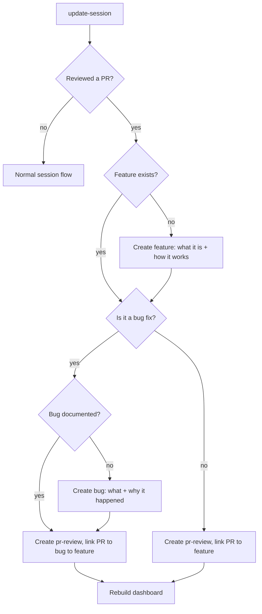

# PR Review Capture

Capture **pull-request reviews** as first-class vault entities, always linked to the bug or feature
they address. Triggered through `update-session` — when the command detects a reviewed PR it runs the
**PR Review Flow** instead of the normal flow. PR reviews are shown in their own dashboard section and
nested under each project/feature, but are kept **out of the Connections graph**.

## How It Works



## Sessions

```dataview
TABLE date, author FROM "projects/knowledge-kit/features/feat-pr-review/sessions" SORT date DESC
```

## PR Reviews

```dataview
TABLE date, status, kind, ref-id FROM "projects/knowledge-kit/features/feat-pr-review/pr-reviews" SORT date DESC
```

# Related
- [[knowledge-kit]]
- [[info-pr-review]]
