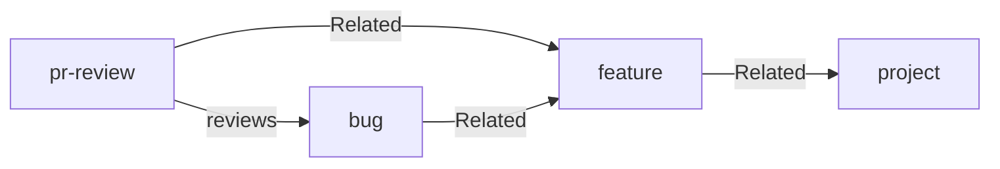

# Current Architecture

PR review capture is a flow inside the existing `update-session` command, plus a new entity type and
a dashboard section. Nothing runs automatically — the engineer triggers it by saying `update-session`
after reviewing a PR.

### Components
- **`_kit/INSTRUCTIONS.md`** — canonical rules. Defines the **§PR Review Flow** (the cascade) and the
  `update-session` Step 0 branch that detects a reviewed PR. Also defines **Living History**.
- **`_guide.md`** — `pr-review` YAML schema, the `pr-YYYY-MM-DD-{desc}.md` content template (plain
  language + mermaid + findings table), and the `## Evolution` convention.
- **`_kit/skills/update-session/SKILL.md`** — step 2.5 routes to the PR Review Flow.
- **`projects/{slug}/features/{feat}/pr-reviews/`** — where `pr-` entities live.
- **Dashboard** — `dashboard/js/views/pr-reviews.js` renders the PR Reviews tab; `build_data.py`
  excludes PR reviews from the Connections graph.

### How the cascade keeps PR reviews from being orphaned

A PR review always lands inside a real feature (created if missing). A bug-fix PR always links to a
real bug (created if missing, with *what it is* and *why it happened*). Non-bug PRs link to the
feature only.

### Known Behaviors
- Trigger is `update-session`; it branches on "did we review a PR?" (Step 0 / step 2.5 of the launcher).
- `kind` drives the cascade: `bugfix` creates/links a bug; `feature`/`refactor`/`chore` link the
  feature only.
- **Per-PR fan-out**: the cascade runs once *per PR reviewed*. N PRs ⇒ N `pr-` files, and each bugfix
  PR ⇒ its own `bug-` file — never merge several real items into one entity.
- PR metadata (`tracker`, `ref-id`, `ref-url`, author, title) is sourced from the conversation; `gh`
  may enrich when a number is known, but is never required. The PR *is* the work item, so its badge is
  the real PR number (e.g. `#24`).
- PR reviews are **excluded from the Connections graph** — `build_relationship_graph` drops their
  nodes and any edge touching them. They still appear in the sidebar tree under their feature.
- Dashboard badge `pr-count` and stats `totalPRReviews`/`openPRReviews` count `type === 'pr-review'`.

### Edge Cases
- PR fixes a bug spanning a missing feature → create feature first, then bug, then PR review.
- PR is not a bug fix and its feature is missing → create the feature (documented), link PR to it,
  no bug created.
- Running `update-session` from inside the vault (no `.knowledge.json` in CWD): entities are still
  written under the resolved project; no repo-side copy step applies to PR reviews.

## File Map
- `_kit/INSTRUCTIONS.md` — §PR Review Flow, Living History, update-session Step 0 branch
- `_guide.md` — `pr-review` schema + template + `## Evolution` convention
- `_kit/skills/update-session/SKILL.md` — step 2.5 PR branch
- `dashboard/build_data.py` — graph exclusion + PR stats
- `dashboard/index.html` — PR Reviews nav item + `view-pr-reviews` section
- `dashboard/js/views/pr-reviews.js` — PR Reviews view (created)
- `dashboard/js/app.js` — renderer registration + `pr-count` badge
- `dashboard/js/components/navigation.js` — `pr-reviews` view title
- `dashboard/js/utils.js` — `pr-review` icon + color; PR badge is the real `#<ref-id>` via `work_item_label`

## Integration Points
- **feat-skill-capture**: same "branch inside update-session + dashboard tab" pattern; the Living
  History rule introduced here applies to skills' docs too.
- **feat-dashboard**: new PR Reviews tab; Connections graph deliberately excludes PR reviews.

## Open Questions
- Should `startday` deep-prime open PR reviews (read them before work), beyond listing them in the brief?
- Should a merged-PR Chain Reaction auto-create an `upd-` when behavior changed, like bug resolution does?

## Evolution
- 2026-06-15 — Created. PR Review Capture feature added: `pr-review` entity type, §PR Review Flow
  cascade, update-session Step 0 branch, dashboard PR Reviews tab, graph exclusion, and the
  cross-cutting Living History rule.
- 2026-06-18 — PR metadata moved from `pr-number`/`pr-url` to the universal `tracker`/`ref-id`/`ref-url`
  work-item scheme (the PR *is* the work item; badge = `#<ref-id>`); made the cascade explicitly
  fan out once per PR. Migrated the 5 existing PR reviews.

# Related
- [[feat-pr-review]]
