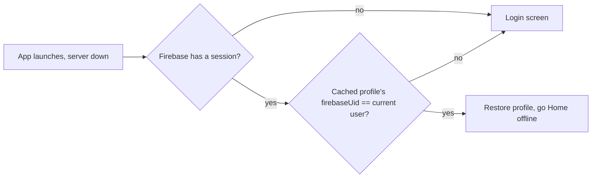

# What This PR Does
Lets a logged-in player open the app and keep using it even when the phone has no
internet — by remembering their last profile on the device. The review made sure
that "remembered" profile can only ever belong to the person actually signed in.

# Why It Was Needed
Before this, if the server was unreachable on launch, an already-authenticated user
was bounced back to the login screen (issue #19). The fix caches the profile so they
stay in. The review caught a sharp edge in that cache: it wasn't tied to *who* it
belonged to.

# How It Works

# Review Findings
| Severity | Finding | Resolved? |
|----------|---------|-----------|
| High | Offline restore checked only `currentUser != null`, not that the cache belonged to the current Firebase user → a second account could inherit the first user's session offline (cache is saved only *after* the server call, so a window exists). | Yes — `1e578ff`: cache bound to `firebaseUid`, restore gated on match |
| Low | `_restoreOfflineSession` returned `true` even when `!mounted` (claimed it navigated when it hadn't). | Yes — returns `false` when not mounted |
| Info | Legacy caches (no `firebaseUid`) — upgrade safety. | Handled — `decode` returns `null`, cache dropped |

# Linked Bug / Feature
Fixes [[bug-2026-06-15-offline-restore-cross-user-identity]] within the
offline-login work for [[feat-profile]]. Merged 2026-06-15.

## Evolution
- 2026-06-15 — PR reviewed; identity-binding bug found, fixed in `1e578ff`, verified, merged.

# Related
- [[feat-profile]]
- [[bug-2026-06-15-offline-restore-cross-user-identity]]
- [[ses-2026-06-15-babysit-and-review-open-prs]]
