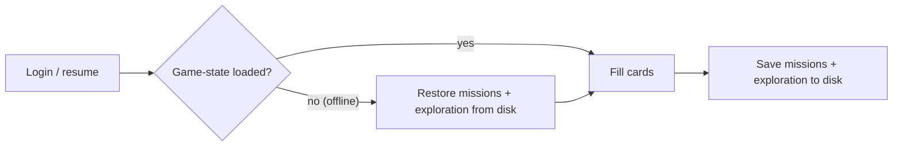

# What This PR Does
Makes the Home page remember your Daily Mission and Area Exploration cards, so they
still show your last-known values when your phone has no internet — instead of going
blank.

# Why It Was Needed
Both cards are filled once, on login/resume, from one server call. Offline that call
returns nothing, and there was no saved copy, so the cards reset to their empty
"loading…" state even though you'd just seen real numbers. Authored by aman (amanshukla446).

# How It Works

A new `GameStateCache` stores the raw `missions` + `exploration` JSON (exactly what the
slices already consume) after every successful load, and restores just those two slices
when the server is unreachable. Tagged with the user's id (cross-user guard), wiped on
sign-out / account deletion. Profile is handled separately by `ProfileCache`;
achievements are intentionally left out (stale achievements shouldn't surface offline).

# Review Findings
| Severity | Finding | Resolved? |
|----------|---------|-----------|
| Verified | Faithful round-trip (raw server lists, absent lists default empty) | n/a — confirmed correct |
| Verified | Cross-user `load` guard correct; scope discipline (only missions+exploration) justified | n/a — confirmed correct |
| Verified | The #44 concern does **not** recur: offline signal is `getGameState` returning `null`, and that pre-existing method already **logs** the failure — restore-on-null is observable, not a new silent catch | n/a — confirmed correct |
| Verified | Strong tests (fails-without-fix regression via real `hydrateAllSlicesFromRef`, cross-user, empty-cache, online-writes-cache); CI fully green | n/a — confirmed correct |
| Minor (non-blocking) | `getGameState` collapses all failures to `null`, so a 5xx also triggers offline-restore — acceptable (logged; last-known beats empty); imprecision is pre-existing | noted |
| Minor (non-blocking) | `_restoreOfflineCards` / `…FromRef` duplicate, mirroring existing `hydrateAllSlices` split | noted, fine as-is |

**Outcome: approved.** No major gaps.

# Linked Bug / Feature
Fixes [[bug-2026-06-18-offline-home-cards-empty]] (issue #34) on the Progression
feature. Same offline-cache lineage as the profile fix
[[bug-2026-06-15-offline-restore-cross-user-identity]] (issue #19).

## Evolution
- 2026-06-18 — PR reviewed in depth (full source + `getGameState`); verified correct,
  approved. Two non-blocking notes recorded.

# Related
- [[feat-progression]]
- [[bug-2026-06-18-offline-home-cards-empty]]
