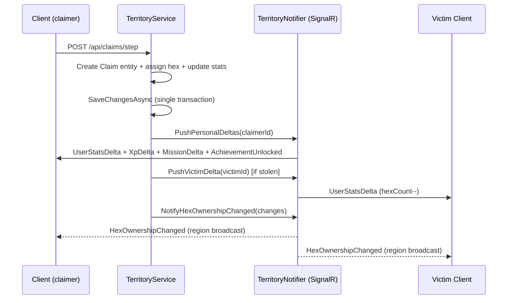

# Current Architecture

### Components
- **GPS Tracking Service (client-side)**: `LocationService` class in `shared/services/location_service.dart`. Uses `geolocator` package (+ `geolocator_web` for browser). Throws descriptive errors for permission states.
- **Background-capable tracking (client-side, PR #26)**: `startTracking()` builds platform-specific settings via the pure `buildTrackingSettings(LocationPlatform)` so position updates keep arriving with the screen off (issue #20). Android → `AndroidSettings` with a `foregroundNotificationConfig` (geolocator runs a location-typed **foreground service**). iOS → `AppleSettings` with `allowBackgroundLocationUpdates: true`, `pauseLocationUpdatesAutomatically: false`, `showBackgroundLocationIndicator: true`. web/other → plain `LocationSettings`. Android manifest declares `FOREGROUND_SERVICE` + `FOREGROUND_SERVICE_LOCATION` and deliberately **omits** `ACCESS_BACKGROUND_LOCATION` (a foreground service does not need it; avoids Play background-location review). iOS relies on `UIBackgroundModes: [location]` already in `Info.plist`.
- **Journey Controller (client-side)**: Riverpod `Notifier` pattern (modern, NOT deprecated StateNotifier). State: `JourneyState` with `isTracking`, `path` (List<LatLng>), `distance`, `duration`, `error`. Try/catch wraps all operations. **GPS drift filtering**: rejects accuracy > 25m, uses speed-aware noise floor (stationary: 10-25m, moving: 6-20m), only records to path/distance when displacement exceeds noise floor.
- **Real-time hex display (client-side)**: App shows all hexagons on the map. As user walks, hexes that are >50% inside their trail/loop turn their color in real-time.
- **Trail + Fill mechanic (simplified)**: Two rules only. (1) Trail cells: any H3 cell whose center the path crosses through → claimed. (2) Interior fill: if path forms a closed loop AND enclosed area ≥ 5,000m², any H3 cell whose center is inside the loop polygon → claimed. NO boundary intersection/overlap check. No 51% rule.
- **H3 Computation (server-side, .NET)**: Uses pocketken.H3 v4.0.0 NuGet package at **Resolution 11** (edge ~29m, area ~2,150m²). `ComputeCapturedCells()` orchestrates trail tracing + polygon fill via focused helper methods (all ≤40 lines). Decomposed into: `AddTrailCells`, `AddLoopFillCells`, `ExtractLoops`/`FindClosureLoops`, `BuildRepairedPolygon`, `DeduplicatePolygons`/`IsDuplicateOf`, `FillPolygonInteriors`. **CRITICAL**: `pocketken.H3`'s `LatLng` constructor expects **radians**, not degrees. Must convert: `latRad = latDeg * Math.PI / 180.0`. The `ToLatLng()` method returns a `LatLng` with `.LatitudeDegrees`/`.LongitudeDegrees` properties for conversion back. `FillPolygon` via NTS `.Fill()` handles conversion internally.
- **Perfect Hex Boundaries (server-side)**: `GetPerfectHexBoundary(lat, lng, radiusMeters=25)` generates visually-perfect regular hexagons. Uses `cos(latitude)` correction for longitude degree offsets. All hexes worldwide are exactly 25m radius (center-to-vertex), flat-top orientation. H3's raw boundaries are NOT used for rendering (they distort at high latitudes).
- **Minimum Fill Area (server-side)**: `GeoService.CalculatePolygonArea()` uses Shoelace formula in metric coordinates. Loops < 5,000m² only get trail cells. (Reduced from 30,000m² because resolution 11 cells are smaller — 5,000m² keeps fill viable for reasonable walks.)
- **Claim API (server-side)**: `POST /api/claims` with path → `ClaimsController` validates → `TerritoryService.ProcessClaim` orchestrates → `HexGridService.ComputeCapturedCells` computes trail + fill → stores in PostgreSQL. `ClaimResult` uses static factory: `ClaimResult.Failure(error)`, `ClaimResult.Succeeded(data)`.
- **Step Claim API (server-side)**: `POST /api/claims/step` with single lat/lng → `TerritoryService.ProcessStepClaim` → creates Claim entity → assigns hex → updates stats → pushes personal deltas via SignalR → pushes victim delta if stolen. Returns `StepClaimResponse` with cellId, boundary, xpGained, achievements, wasStolen, previousOwnerName.
- **Trail Claim API (server-side)**: `POST /api/claims/trail` with path → `TerritoryService.ProcessTrailClaim` → creates Claim entity → assigns all trail + fill cells → updates stats → pushes all deltas. Same push pattern as step claim but batched.
- **Claim Entity Creation (CRITICAL)**: Both `ProcessStepClaim` and `ProcessTrailClaim` MUST create a `Claim { Id, UserId, CellCount, AreaM2 }` entity BEFORE inserting `TerritoryCell` records. FK constraint: `TerritoryCells.ClaimId → Claims.Id`. Omitting this causes PostgreSQL FK violation.
- **Post-Claim Push Pipeline**: After `SaveChangesAsync` succeeds, TerritoryService calls:
  1. `PushPersonalDeltas(userId)` → fires UserStatsDelta, XpDelta, MissionDelta, AchievementUnlocked to claiming user's SignalR group
  2. `PushVictimDelta(victimId)` → fires UserStatsDelta to victim's SignalR group (decremented hexCount)
  3. `NotifyHexOwnershipChanged(changes)` → fires to region groups (public map update)
  4. FCM notification to victim (background theft alert)
- **Service Architecture (SOLID)**: All services have proper interfaces (`IHexGridService`, `ITerritoryService`, `IUserService`, `ILeaderboardService`, `IGeoService`, `IValidationService`). All dependencies constructor-injected. No method exceeds 40 lines. One class per file.
- **Constants**: All magic numbers extracted to `GameConstants` class — `MinLoopPoints`, `LoopSkipNeighbors`, `DeduplicationOverlapThreshold`, `MinFillAreaSquareMeters`, `CellCooldownHours`, etc.
- **Cell Cooldown**: A cell cannot be re-stolen within `CellCooldownHours` (5 hours) of its last transfer. Anti-grief mechanic.
- **User Territories API**: `GET /api/territories/user/{userId}` — returns ALL cells owned by user (no viewport limit). Used by mobile map to guarantee user always sees their hexes regardless of current GPS location.
- **Claim History API**: `GET /api/territories/claims/{userId}` — returns chronological claim history (ClaimId, CellCount, AreaM2, Date). Used by home page "Hex History" widget.
- **Claim Flow (client-side)**: All claim logic lives in `_JourneyScreenState._onStopCapture()` — NOT in child widgets. Uses lifecycle-stable `context` for dialogs. Reads fresh state via `ref.read()` to avoid stale closures. Sequence: submitClaim → showCapturedHexes → optimistic badge update → forceReloadHexes → getUser → getLeaderboard → updateStats(all 4 fields) → showCelebration.
- **Frontend decomposition**: `LoopDetector` (static class, mirrors backend ExtractLoops), `HexTerritoryManager` (hex loading/state management), `CelebrationDialog` (standalone widget). JourneyScreen extracted: `_CircleButton`, `_HexOwnerSheet`, `_StatsBar`, `_BottomControls`. Map build split into focused methods.
- **Conflict Resolution (server-side)**: Last-writer-wins. Walking through someone's hex steals it.
- **Ownership History**: `CellTransfers` table logs every ownership change with `FromUserId`, `ToUserId`, `ClaimId`, `TransferredAt`. `TerritoryCell.PreviousOwnerId` stores last owner for fast single-query lookups. Powers the "revenge recapture" feature (Clash of Clans model: raid → lose hexes → see what was taken → go reclaim).
- **Spatial Indexing**: `TerritoryCell` stores `CenterLat` + `CenterLng` (double) for viewport queries. See spatial index decision section below.
- **Anti-cheat on batch-step path (server-side, abb321a)**: `IPathValidationService.ValidateConsecutivePoints((Lat,Lng,CapturedAt)[])` now guards the real-time batch-step claim path (the PRIMARY way players claim). Bounds each GPS hop by `AntiCheatConstants.MaxSpeedMetersPerSecond * elapsedSeconds + 30m` drift margin using the real `CapturedAt` timestamps; rejects when implausible-hop rate exceeds the existing 5% tolerance. Wired into `ClaimBatchStep` → `400 {error:"Anti-cheat: ..."}`. Previously only loop claims were validated, so a spoofer could teleport on the batch path.
- **Real walked distance on batch path (server-side, abb321a)**: `ProcessBatchStep` now computes real GPS distance via `IGeoService.CalculatePathDistance` for the slice and adds it to `Users.DistanceKm` (recomputed per retry → no double counting). Real metres also feed the `WalkDistance` mission. Previously only the loop path incremented `DistanceKm`, so walk-and-claim players had `DistanceKm=0`.
- **Resilient SignalR broadcasts (server-side, abb321a)**: `NotifyHexOwnershipChanged` wraps each region send in its own try/catch (one failed region no longer aborts the rest); personal-delta pushes go through a generic `SafeSendToUser<T>` that logs and never throws (fire-and-forget pushes can no longer surface as unobserved task exceptions).
- **Offline claim queue + crash-safe WAL (client-side, abb321a)**: GPS step points are appended to an on-disk write-ahead log (`StepClaimQueue`) and drained in batches by `BatchDrainService` (exponential backoff 1s→30s). `StepClaimQueue` uses `_atomicWrite` — write to a sibling `.tmp`, flush, then atomically `rename` over the target — so a crash mid-write can only leave an ignored temp file, never a truncated/lost WAL.
- **WAL write serialization (client-side, PR #17)**: Every disk-mutating `StepClaimQueue` op (`enqueue` append, `removeProcessed`/`clear` rewrite) runs through a `_writeLock` future chain (`_synchronized`). Without it, an `enqueue` append can interleave with a rewrite: the rewrite snapshots the cache, the append lands on the file, then the rewrite's atomic `rename` replaces the file with a snapshot lacking the just-appended point — losing a queued GPS point if the OS kills the app. Regression test added in PR #25 (`step_claim_queue_test.dart`): proven to fail against the pre-#17 unserialized version and pass with the lock.
- **Permanent vs transient batch failures (client-side, abb321a)**: `claimBatchStep` distinguishes 4xx (throws `BatchRejectedException` carrying the server message via `extractApiError`) from 5xx/offline (returns null → retry with backoff). The drainer drops permanently-rejected points, resets backoff, and emits the reason on `onRejection`, which the journey controller surfaces via its existing `error` state. Previously every error collapsed to null and a poisoned batch (e.g. the new anti-cheat 400) would retry forever silently.

### Known Behaviors
- H3 Resolution 11: ~29m edge, ~2,150m² area per cell. Smaller than res 10 — feels more earnable per walk.
- Territory = set of H3 cell IDs (64-bit integers) owned by a user
- Capture = trail (center of hex within path corridor) + fill (center of hex inside closed polygon). NO boundary intersection checks.
- Loop closure: path self-intersection detected via `FindClosureLoops` (point within 50m of earlier non-adjacent point). NOT just first-to-last.
- GPS accuracy: ±5-15m outdoor clear, ±20-50m urban obstructed
- Minimum path length: 200m (anti-abuse)
- Maximum claim area: 5km² per claim (anti-abuse)
- Rate limit: max 20 claims per day per user
- **pocketken.H3 LatLng expects RADIANS** — passing degrees produces cells at wrong locations (typically shifted towards higher lat/lng values, e.g., Bangalore → Pacific/Japan). Only `AddTrailCells` needs manual conversion; `FillPolygonInteriors` via NTS `.Fill()` handles it internally.
- H3 Cell IDs are 64-bit integers (~15 digits at res 11). Safe on mobile Dart (64-bit int) but overflows JavaScript `Number.MAX_SAFE_INTEGER` (2^53) on web. Not a blocker for iOS-first.
- **Deduplication**: Overlapping polygons (>80% area shared) are deduplicated before fill to prevent double-counting.
- **Loop detection constants**: `MinLoopPoints=20` (don't bother looking for loops in short paths), `LoopSkipNeighbors=10` (skip adjacent points when searching for crossings).
- **Offline own-hexes cache (client-side, PR #44 / issue #33, in review)**: `HexTerritoryManager.loadUserOwnHexes()` caches the fetched owned set to a file-backed, user-bound `TerritoryCache` on success and restores it when the fetch fails, so the Start Journey map still shows the player's territory offline instead of a blank grid. Cross-user binding guard + cleared on sign-out/account-deletion (mirrors `ProfileCache`, #19). Review-pending change: narrow the blanket `catch` to `isServerUnreachable` so non-offline errors aren't masked. See [[skl-offline-first-user-bound-cache]].
- **Sustained-speed anti-cheat (server-side, PR #42 / issue #37, in review)**: `ValidateConsecutivePoints` adds a window-average gate (`AntiCheatConstants.MaxAverageSpeedMetersPerSecond ≈ 9 m/s`) over the whole batch on top of the per-hop bound. The flat +30 m per-hop GPS-drift margin inflated the effective per-hop ceiling to ~51 km/h, letting a steady ~40 km/h vehicle pass every hop; the batch-average gate rejects sustained vehicle speed the per-hop check misses.
- **Offline journey-start block (client-side, PR #43 / issue #35, in review)**: `JourneyController.startJourney` probes `ApiService.isServerReachable()` (short-timeout GET to the anonymous health endpoint) before any GPS work; offline it sets a clear error (shown via the existing red SnackBar) and does not start. Hex capture is server-authoritative, so starting offline produced no preview/claims/feedback. Mid-journey drops stay handled by the `StepClaimQueue` WAL.

### Edge Cases
- GPS drift creates invalid polygon → path simplification + server validates polygon is valid
- User loses GPS signal mid-capture → client stores last known position, resumes on re-acquisition
- User's path crosses itself → take outer boundary only
- User starts capture, never closes loop → auto-cancel after 4 hours or manual discard
- Two users submit overlapping claims simultaneously → last-to-commit wins (serialized at DB level)
- GPS spoofer teleports on the batch-step path → `ValidateConsecutivePoints` rejects with `400 Anti-cheat: ...` (abb321a); empty / zero-timestamp batches handled without false rejects
- App crashes mid WAL write → `_atomicWrite` (tmp + rename) guarantees the queue is never truncated; only an ignored `.tmp` file can remain
- Concurrent `enqueue` + `removeProcessed`/`clear` on the WAL → serialized by `_writeLock` (PR #17); without it the rewrite's rename clobbers a just-appended point (data loss). Guarded by `step_claim_queue_test.dart` (PR #25)
- Screen off / app backgrounded mid-walk → position stream kept alive by an Android foreground service / iOS background updates (PR #26); pre-fix the path collapsed to a straight line and route hexes were lost (issue #20)
- "While in use"-only location grant → foreground tracking still works; `LocationService` logs a warning that background delivery may be throttled until all-the-time access is granted
- Server permanently rejects a batch (4xx, e.g. anti-cheat) → drainer drops those points, resets backoff, surfaces the reason via `onRejection` (no infinite retry loop)

## Spatial Indexing Decision

### Problem
Viewport query `GET /api/territories?bounds=...` currently loads ALL cells into memory and filters in C#. Fails at ~5,000+ cells.

### Options Evaluated

| Approach | Index | Truly 2D? | Extension Needed? | Verdict |
|----------|-------|-----------|------------------|---------|
| `(lat, lng)` composite B-tree | B-tree | ❌ 1D primary sort | No | Rejected — lat range scan works, lng is post-filter |
| PostgreSQL native `point` + GiST | GiST | ✅ Yes | No — ships with PG | **Chosen** |
| PostGIS `geometry` + GiST | GiST | ✅ Yes | Yes — PostGIS | Deferred — overkill until Martin tiles needed |
| Geohash (text, B-tree prefix) | B-tree | ✅ Effectively | No | Future option — H3 parent cell is equivalent |

### Why composite B-tree on (lat, lng) is wrong
B-tree sorts by lat first, lng second. A bounding box query gets efficient lat range scan, but lng is evaluated as a post-scan filter on every row in the lat band — not a true 2D operation. Degrades badly at city scale.

### Chosen: PostgreSQL native `point` + GiST
- `point` type ships with PostgreSQL — no extension to install
- GiST index on `point` column = true 2D spatial index (both dimensions used in tree traversal)
- Viewport query: `WHERE center <@ box '((lng1,lat1),(lng2,lat2))'`
- Maps to `NpgsqlPoint` in .NET, zero extra dependencies

### Why PostGIS is deferred (not rejected forever)
PostGIS becomes the right choice when:
1. **Martin vector tiles** are adopted — Martin reads PostGIS geometry columns directly
2. Complex spatial ops needed (polygon buffers, distance queries, etc.)
Adding a `geometry` column later is a non-breaking migration. No wasted work.

### Extensibility Path
```
Now:      CenterLat/Lng doubles + GiST on point column
Later:    + PostGIS geometry column  →  Martin vector tiles
Future:   + Geohash column (text)    →  prefix sharding
Always:   H3 parent cell (ParentCellId, res 3) stored  →  H3-native hierarchy queries
```

`ParentCellId` (H3 resolution 3, stored as `long`) is a native H3 geohash equivalent. It costs one int64 per row and enables partition-style queries by area without any extension. H3 cell IDs are a spatial hash by design.

## Ownership History Design

### CellTransfers table (NEW)
```
CellTransfers
├── Id (Guid PK)
├── CellId (bigint FK → TerritoryCells)
├── FromUserId (Guid? — null means was previously unclaimed)
├── ToUserId (Guid FK → Users)
├── ClaimId (Guid FK → Claims)
├── TransferredAt (timestamp)
└── INDEXES:
    (FromUserId, TransferredAt DESC) — "hexes stolen from me, most recent first"
    (ToUserId, TransferredAt DESC)   — "hexes I've captured"
    (CellId)                         — "full history of this hex"
```

### Queries this enables
- `"Show me my stolen hexes"` → `WHERE FromUserId = me AND TransferredAt > 7d ago`
- `"Who keeps raiding me?"` → `GROUP BY ToUserId WHERE FromUserId = me ORDER BY count DESC`
- `"Most contested hex in city"` → `GROUP BY CellId ORDER BY COUNT(*) DESC`
- `"Territory I've held longest"` → `TerritoryCells WHERE OwnerId = me ORDER BY ClaimedAt ASC`
- `"Revenge: recapture within 24h"` → `WHERE FromUserId = me AND TransferredAt > 24h ago AND current OwnerId != me`

### PreviousOwnerId on TerritoryCell (fast path)
Dual approach: `CellTransfers` for full audit trail, `PreviousOwnerId` on the cell itself for single-query "who did I steal this from?" — avoids a JOIN for the common case.

## File Map

### Backend — Services (all have interfaces)
- `api/MyLoop.Api/Services/HexGridService.cs` — Trail cell computation (degrees→radians→H3), loop detection, polygon fill, boundary generation. All methods ≤40 lines.
- `api/MyLoop.Api/Services/IHexGridService.cs` — Interface for hex computation
- `api/MyLoop.Api/Services/TerritoryService.cs` — ProcessClaim orchestrator, cell assignment, ownership transfer, stats update, **push delta firing**. Decomposed into ValidateClaim, CreateClaimEntity, AssignCells, PushPersonalDeltas, PushVictimDelta.
- `api/MyLoop.Api/Services/ITerritoryService.cs` — Interface with ClaimResult (static factory pattern)
- `api/MyLoop.Api/Services/TerritoryNotifier.cs` — SignalR push: 5 methods (hex changes, stats, xp, missions, achievements). Groups by H3 parent for public, `user_{id}` for personal.
- `api/MyLoop.Api/Interfaces/ITerritoryNotifier.cs` — Interface + all push payload records (HexChangeEvent, UserStatsDelta, XpDelta, MissionDelta, AchievementDelta, etc.)
- `api/MyLoop.Api/Services/UserService.cs` — Register, identity resolution, profile queries, deletion
- `api/MyLoop.Api/Services/IUserService.cs` — Interface for user operations
- `api/MyLoop.Api/Services/LeaderboardService.cs` — GetLeaderboard, RefreshLeaderboard, BuildScopedQuery, UpdateAchievementCounters
- `api/MyLoop.Api/Services/ILeaderboardService.cs` — Interface for leaderboard
- `api/MyLoop.Api/Services/GeoService.cs` — Haversine distance, polygon area (Shoelace formula), coordinate math
- `api/MyLoop.Api/Services/IGeoService.cs` — Interface for geographic calculations
- `api/MyLoop.Api/Services/ValidationService.cs` — Input validation (name, path, bounds)
- `api/MyLoop.Api/Services/IValidationService.cs` — Validation interface
- `api/MyLoop.Api/Services/PathValidationService.cs` — Anti-cheat: `Validate(path)` (loop: speed/duration/smoothness) + `ValidateConsecutivePoints(points)` (batch-step: per-hop speed bound). abb321a
- `api/MyLoop.Api/Interfaces/IPathValidationService.cs` — Path-validation interface (both methods)

### Backend — Controllers (thin, ≤20 lines per action)
- `api/MyLoop.Api/Controllers/ClaimsController.cs` — POST /api/claims, POST /api/claims/step, POST /api/claims/batch-step (anti-cheat validated, abb321a), POST /api/claims/trail, GET /api/claims/preview, POST /api/claims/dev/test-push (DEV ONLY). Now depends on `IPathValidationService`.
- `api/MyLoop.Api/Controllers/TerritoryController.cs` — GET viewport, user hexes, stolen, history
- `api/MyLoop.Api/Controllers/UsersController.cs` — Register, GET profile, PATCH update, DELETE, GET /api/users/{id}/game-state (hydration endpoint)
- `api/MyLoop.Api/Controllers/LeaderboardController.cs` — GET leaderboard, rank

### Backend — SignalR Hub
- `api/MyLoop.Api/Hubs/TerritoryHub.cs` — JoinRegion, LeaveRegion, JoinUserGroup (validates auth), LeaveUserGroup. No [Authorize] on class (mixed auth).

### Backend — Models (one class per file)
- `api/MyLoop.Api/Models/ClaimRequest.cs` — Path submission DTO
- `api/MyLoop.Api/Models/PreviewRequest.cs` — Preview path DTO
- `api/MyLoop.Api/Models/ClaimResponse.cs` — Claim result + ClaimHistoryEntry
- `api/MyLoop.Api/Models/TerritoryResponses.cs` — TerritoryCellResponse, TerritoryStatsResponse, StolenCellsResponse, StealerSummary, StolenCellDetail, CellHistoryResponse, CellOwnerInfo, CellTransferDetail
- `api/MyLoop.Api/Models/RegisterRequest.cs` — User registration DTO
- `api/MyLoop.Api/Models/UpdateUserRequest.cs` — Profile update DTO
- `api/MyLoop.Api/Models/UserProfileResponse.cs` — Profile response DTO
- `api/MyLoop.Api/Models/LeaderboardResponse.cs` — Leaderboard + MyRankResponse + LeaderboardEntryResponse
- `api/MyLoop.Api/Models/HexCell.cs` — Hex cell domain model
- `api/MyLoop.Api/Models/GeoCoordinate.cs` — Lat/lng coordinate model

### Backend — Constants & Config
- `api/MyLoop.Api/Constants/GameConstants.cs` — ALL game constants (no magic numbers anywhere)
- `api/MyLoop.Api/Constants/AntiCheatConstants.cs` — `MaxSpeedMetersPerSecond`, `MaxSpeedViolationRate`, smoothness/bearing thresholds (anti-cheat tuning)
- `api/MyLoop.Api/Program.cs` — .NET 10 minimal API entry point, DI registration, migration SQL
- `api/MyLoop.Api/appsettings.json` — PostgreSQL connection string
- `api/MyLoop.Api/Data/AppDbContext.cs` — CellTransfers DbSet, spatial indexes

### Backend — Entities
- `api/MyLoop.Api/Entities/TerritoryCell.cs` — CellId, OwnerId, BoundaryJson, CenterLat, CenterLng, ParentCellId
- `api/MyLoop.Api/Entities/CellTransfer.cs` — Ownership history record
- `api/MyLoop.Api/Entities/Claim.cs` — Id, UserId, CellCount, AreaM2, CreatedAt
- `api/MyLoop.Api/Entities/ExploredCell.cs` — Per-user first-visit record (feeds ExploreNewArea mission; purged on account deletion)

### Frontend — Journey Feature (decomposed)
- `mobile/lib/features/journey/journey_screen.dart` — Map view with extracted widgets (_CircleButton, _HexOwnerSheet, _StatsBar, _BottomControls), claim flow in _JourneyScreenState
- `mobile/lib/features/journey/journey_controller.dart` — Riverpod Notifier, JourneyState, GPS drift filtering, uses LoopDetector; subscribes to `BatchDrainService.onRejection` → sets `error` state (abb321a)
- `mobile/lib/features/journey/loop_detector.dart` — Static class `LoopDetector.countLoops(path)` mirroring backend ExtractLoops algorithm
- `mobile/lib/features/journey/hex_territory_manager.dart` — `HexTerritoryManager` class: loadUserOwnHexes (offline-cache fallback via TerritoryCache, PR #44), loadWideArea, loadViewport, updateFromCells, addCapturedHexes
- `mobile/lib/shared/services/territory_cache.dart` — file-backed, user-bound offline cache of the player's own hexes; save-on-success / restore-on-offline, cross-user guard (PR #44, issue #33)
- `mobile/lib/shared/models/territory_cell.dart` — adds `toJson()` so cached cells round-trip identically to `fromJson` (PR #44)
- `mobile/test/territory_offline_cache_test.dart` — codec + disk-durability + offline-restore (fails-without-fix) tests for TerritoryCache (PR #44)
- `tests/MyLoop.Api.Tests/PathValidationServiceTests.cs` — batch-speed anti-cheat tests incl. sustained-vehicle rejection / fast-run acceptance (PR #42)
- `mobile/lib/features/journey/celebration_dialog.dart` — Standalone celebration widget (post-claim)
- `mobile/lib/features/journey/hex_overlay.dart` — AnimatedHexOverlay with 3 zoom tiers

### Frontend — Shared
- `mobile/lib/shared/services/location_service.dart` — GPS permissions + tracking (geolocator); `buildTrackingSettings` selects Android foreground-service / iOS background settings for screen-off recording (PR #26)
- `mobile/android/app/src/main/AndroidManifest.xml` — location + `FOREGROUND_SERVICE`/`FOREGROUND_SERVICE_LOCATION` perms; no `ACCESS_BACKGROUND_LOCATION` (PR #26)
- `mobile/test/location_tracking_settings_test.dart` — unit tests for `buildTrackingSettings` per platform (PR #26)
- `mobile/test/step_claim_queue_test.dart` — regression test for the WAL write-lock; fails pre-#17, passes with lock (PR #25)
- `mobile/lib/shared/services/api_service.dart` — getUserTerritories(), getClaimHistory(), submitClaim(), getGameState(), claimBatchStep() (throws `BatchRejectedException` on 4xx, null on 5xx/offline; `extractApiError` static helper)
- `mobile/lib/shared/services/step_claim_queue.dart` — On-disk WAL for GPS step points: enqueue (append+flush), `_readAll`, `removeProcessed`, crash-safe `_atomicWrite` (tmp + rename). abb321a
- `mobile/lib/shared/services/batch_drain_service.dart` — Drains the WAL in batches with exponential backoff (1s→30s); `onBatchResult` + `onRejection` streams; drops permanently-rejected points. abb321a
- `mobile/lib/shared/services/territory_realtime_service.dart` — SignalR connection lifecycle, 5 event streams (HexOwnershipChanged, UserStatsDelta, XpDelta, MissionDelta, AchievementUnlocked), reconnect logic
- `mobile/lib/shared/state/profile_slice.dart` — ProfileState notifier (hexCount, totalHexesCaptured, totalHexesStolen, streak, isStreakActive, distanceKm, rank)
- `mobile/lib/shared/state/xp_slice.dart` — XpState notifier (totalXp, level, progressXp, neededXp, progressPercent)
- `mobile/lib/shared/state/missions_slice.dart` — MissionsState notifier (missions list, allComplete)
- `mobile/lib/shared/state/achievements_slice.dart` — AchievementsState notifier (achievements list)
- `mobile/lib/shared/state/exploration_slice.dart` — ExplorationState notifier (neighborhoods list)
- `mobile/lib/shared/state/hydration.dart` — Orchestrator: calls GET /game-state → distributes to all 5 slice notifiers

## GPS/Location Implementation Details
- `LocationService.requestPermission()` throws exceptions with user-friendly messages:
  - "Location services are disabled. Please enable GPS."
  - "Location permission denied. Please allow location access in settings."
  - "Location permanently denied. Please enable location in your device settings, then try again." + auto-opens `Geolocator.openAppSettings()`
- `getCurrentPosition()` uses `LocationSettings(accuracy: high, timeLimit: 15s)`
- `startTracking()` returns a stream with a 5m distance filter, now via `buildTrackingSettings(currentLocationPlatform())` for background-capable delivery (PR #26)
- Web requires `geolocator_web` package — browser shows native permission popup
- Web limitation: some browsers require HTTPS for geolocation (localhost exempt)
- `isLocationServiceEnabled()` wrapped in try-catch (unreliable on web browsers)
- Journey controller error messages: stripped "Exception: " prefix for cleaner display
- Journey controller shows errors via `ref.listen` → SnackBar in UI

## Integration Points
- GPS tracking feeds path data to loop detection
- Loop detection triggers claim submission to backend API
- Backend computes H3 cells in .NET code (no database extension needed)
- Territory stored in PostgreSQL with CenterLat/CenterLng for spatial viewport queries (GiST on `point` column)
- CellTransfer record created for every ownership change — powers revenge recapture feature
- Stolen cells trigger push notification to previous owner (FCM — not yet implemented)
- **ProcessStepClaim → MissionService.RecordProgress**: Feeds CaptureHexes, StealHex, CaptureInOneWalk, WalkDistance, ExploreNewArea, MaintainStreak
- **ProcessStepClaim → AchievementService.CheckAndUnlock**: Checks all 30 achievement thresholds after every capture
- **ProcessStepClaim → TerritoryNotifier**: Pushes 4 personal deltas (stats, xp, missions, achievements) + 1 victim delta (stats) + 1 public region broadcast (hex ownership change)
- **ProcessTrailClaim → Same pipeline**: Identical push sequence after loop/trail claim

## Real-Time Push After Claim


- **ProcessStepClaim → MissionService.AwardXp**: Single save point for entire operation (hex + missions + achievements + XP)
- **TotalHexesStolen**: Incremented in ProcessStepClaim when `existing != null`
- **RecordExploration** returns `bool` (true if new cell) → feeds ExploreNewArea mission type

## Open Questions
- Exact Kalman filter parameters for GPS smoothing (tune with real device data)
- Should "capture mode" show other users' active paths? (probably no — privacy + complexity)
- ~~Minimum enclosed area threshold~~ → Decided: 5,000m² (was 30,000m², reduced for res 11 smaller cells)
- How to handle captures that cross city/zone boundaries
- Revenge UI: show stolen hexes as red overlay on map? How long before they fade?
- Revenge bonus: extra XP for recapturing within 24h? (game design decision)
- Resolution 11 feel: does ~29m cell edge produce satisfying density on real device walks?
- Cell cooldown (5h) — balanced for competitive play?

## Evolution
- 2026-06-15 — Documented `StepClaimQueue` WAL write-lock serialization (PR #17) + its regression test (PR #25), and background-capable GPS tracking via Android foreground service / iOS background updates (PR #26, issue #20). Added matching edge cases and File Map entries.
- 2026-06-18 — Added three offline/anti-cheat behaviors from the review-loop session: offline own-hexes `TerritoryCache` (PR #44, issue #33), sustained-speed batch-average anti-cheat gate (PR #42, issue #37), and the offline journey-start block (PR #43, issue #35). All three were authored/reviewed this session and are in review (not yet merged). File Map updated. See [[ses-2026-06-18-review-loop-offline-prs]].

# Related
- [[feat-territory-capture]]
- [[skl-offline-first-user-bound-cache]]
