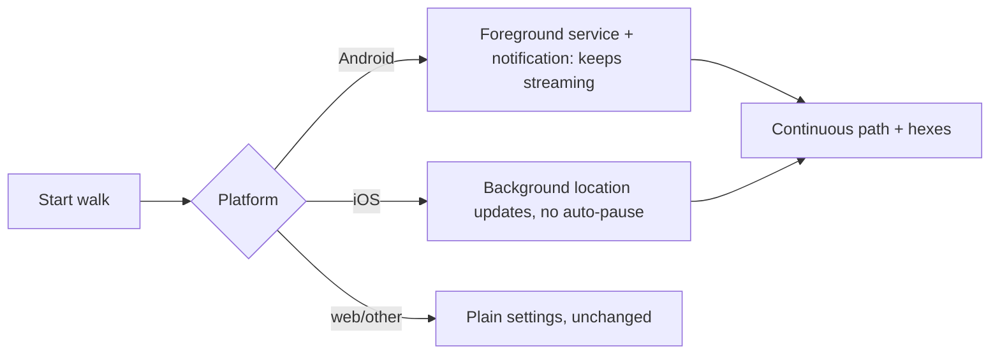

# What This PR Does
Keeps the GPS recording your walking path even when the phone is locked or the app
is in the background — so the captured territory matches the route you actually walked.

# Why It Was Needed
Issue #20: with the screen off, the phone stopped sending location updates, so the
path collapsed into a straight line and the hexes along the real route were lost.

# How It Works

# Review Findings
| Severity | Finding | Resolved? |
|----------|---------|-----------|
| Verify | iOS `allowBackgroundLocationUpdates: true` throws at runtime without `UIBackgroundModes: location` — CI can't catch it. | Verified present in `Info.plist` (+ both usage descriptions) |
| Verify | Android background via foreground service correctly omits `ACCESS_BACKGROUND_LOCATION` (avoids Play review). | Confirmed; `8d9c756` keeps it removed |
| Info | Real background behavior is not unit-testable. | Flagged for on-device QA (notification clears on walk end; battery from `enableWakeLock`) |
| — | No correctness issues in `buildTrackingSettings` (pure, all 3 platform branches tested). | Approved |

# Linked Bug / Feature
Fixes [[bug-2026-06-15-walk-path-not-recorded-in-background]] for
[[feat-territory-capture]]. Approved 2026-06-15 (open at capture time).

## Evolution
- 2026-06-15 — PR reviewed high-effort; iOS background-mode claim verified; approved. Author later confirmed store-compliance posture.

# Related
- [[feat-territory-capture]]
- [[bug-2026-06-15-walk-path-not-recorded-in-background]]
- [[ses-2026-06-15-babysit-and-review-open-prs]]
