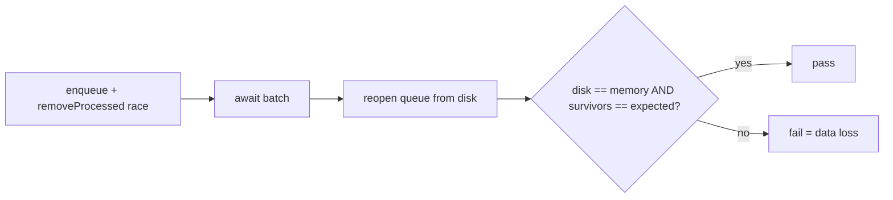

# What This PR Does
Adds the regression test that was missing for the `StepClaimQueue` write-lock —
the lock (merged earlier in PR #17) serializes the on-disk GPS-queue writes so a
queued point can't be silently lost.

# Why It Was Needed
PR #17 fixed a real data-loss race (an `enqueue` append interleaving with a
`removeProcessed`/`clear` rewrite, whose atomic rename clobbers the appended point)
but merged with no test. This PR closes that gap, scoped against `master`. It was
split out of the docs PR #22, whose stale branch carried a byte-identical duplicate
of the already-merged #17 fix.

# How It Works

# Review Findings
| Severity | Finding | Resolved? |
|----------|---------|-----------|
| Medium (self-review) | Asserting only `disk == memory` could pass on total data loss (both empty). | Yes — added explicit `{x,y}` surviving-set assertion |
| — | Test proven to **fail** against the pre-#17 unserialized version and **pass** with the lock. | Confirmed by reverting source locally |

# Linked Bug / Feature
Documents/guards the write-lock in [[feat-territory-capture]] (StepClaimQueue WAL).
No new bug — the underlying fix shipped in #17. PR open (CI green, awaiting external review).

## Evolution
- 2026-06-15 — Created from #22 split; self-reviewed, surviving-set assertion added; opened.

# Related
- [[feat-territory-capture]]
- [[ses-2026-06-15-babysit-and-review-open-prs]]
