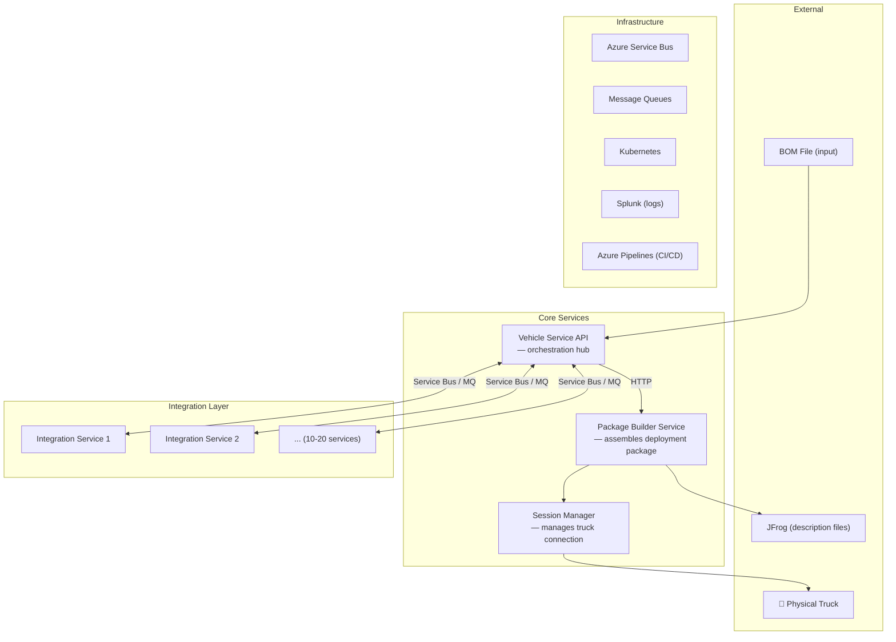

# Volvo Digital Twin — Architecture Spec

## Purpose

Maintain an accurate digital representation of every truck's ECU hardware and software configuration. When updates are needed, orchestrate the full lifecycle: receive BOM → build package → establish session → deploy to truck.

## Service Map

## Key Contracts

| From | To | Protocol | Purpose |
|------|----|----------|---------|
| External | Vehicle Service | HTTP API | Submit BOM for processing |
| Vehicle Service | Package Builder | HTTP / Service Bus | Trigger package build |
| Package Builder | JFrog | HTTP | Fetch description files, store packages |
| Vehicle Service | Session Manager | HTTP / Service Bus | Create deployment session |
| Session Manager | Truck | Proprietary | Deploy package to ECU |
| Vehicle Service | Integration Services | Service Bus / MQ | Orchestration events |

## Data Flow

1. **BOM arrives** at Vehicle Service API
2. Vehicle Service validates and routes to **Package Builder**
3. Package Builder fetches description files from **JFrog**, assembles package
4. Vehicle Service tells **Session Manager** to create a session with the truck
5. Session Manager connects to the truck and **deploys** the package
6. Integration services listen on the bus for events at each stage

## Open Questions
- Exact list of integration services and what each does
- Authentication/authorization model between services
- Error handling and retry patterns
- How rollback works if deployment fails
- BOM file format and validation rules

## Evolution
- 2026-11-18 — Initial spec created from onboarding conversation. High-level flow only; details to be filled as work progresses.
