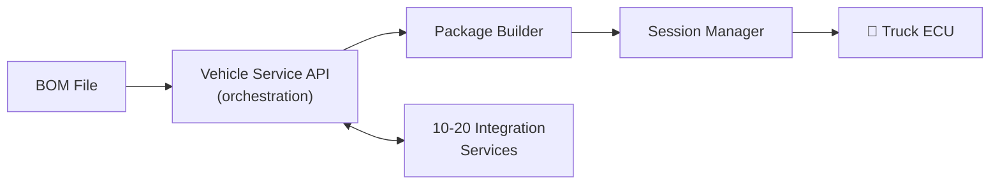

# Volvo Trucks Digital Twin

Backend microservice system that maintains a **digital twin** of each truck — tracking which ECUs (Electronic Control Units) and software versions are installed. When a change is needed, it receives a BOM (Bill of Materials) file, builds a deployment package, creates a session with the physical truck, and deploys the update.

## High-Level Flow



## Communication

| Method | Used For |
|--------|----------|
| HTTP direct calls | Synchronous service-to-service |
| Service Bus (Azure) | Async messaging between services |
| Message queues | Event-driven integration services |

## Infrastructure

| Tool | Purpose |
|------|---------|
| Azure Pipelines | CI/CD |
| Kubernetes (K8s) | Container orchestration, deployment |
| JFrog | Artifact hosting (description files, packages) |
| Splunk | Log aggregation and search |
| GitHub | Source code |

## Data Types

Part numbers, XML descriptors, BOM files, ECU hardware data, software version data, description files.

## Features

```dataview
TABLE status FROM "projects/volvo-digital-twin/features" WHERE role = "hub" SORT file.name ASC
```

## Systems

```dataview
TABLE status FROM "projects/volvo-digital-twin/systems" SORT file.name ASC
```

## Evolution
- 2026-11-18 — Project created. Initial architecture captured from onboarding conversation.

# Related
